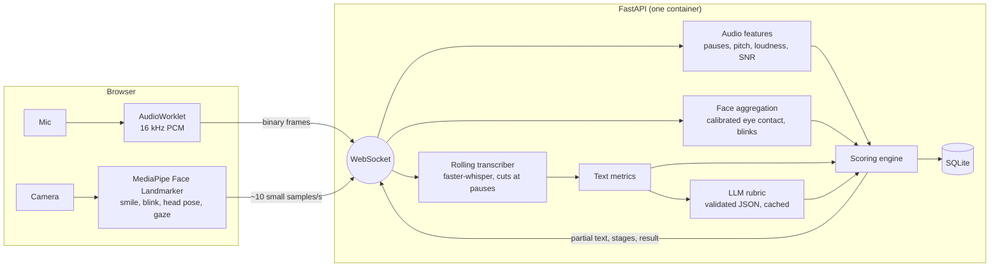

# AI Interview Analyzer

Practice an interview answer in your browser and get a scored report on three things: **how you sound**, **how you come across on camera**, and **how good the answer is**. Every score shows the measurement and the reason behind it, plus a ranked list of fixes with the points each one could earn.

- Runs in the browser (mic + camera captured client-side, so it works when deployed).
- Speech is transcribed locally with `faster-whisper` while you are still talking, so the report appears seconds after you stop.
- Answer quality is graded against a five-criteria rubric by any OpenAI-compatible LLM (Mistral by default), with a safe rule-based fallback.
- Your video never leaves your device. Audio is analysed in memory and never written to disk.

## Quick start

### Docker (recommended)

```bash
cp .env.example .env        # add LLM_API_KEY (optional but recommended)
docker compose up --build   # first build downloads the speech model (~500 MB)
```

Open http://localhost:8000. Camera and microphone need **HTTPS or localhost**.

### Local development

```bash
./scripts/dev.sh            # backend :8000 (reload) + frontend :5173
# or manually:
cd backend  && pip install -r requirements.txt && uvicorn app.main:get_app --factory --reload
cd frontend && npm install && npm run dev
```

`npm install` copies MediaPipe's WASM and downloads the 4 MB face model into `frontend/public/mediapipe/`. If you are offline, download it manually (the script prints the command). Without it the app still works and simply skips expression analysis.

Analyse a recording without the UI:

```bash
cd backend && python -m app.cli answer.wav --topic "Tell me about yourself"
```

## How it works



Why it is fast: while you speak, finished stretches of audio (cut at natural pauses) are transcribed in the background. When you press Finish only the last few seconds remain, and the audio analysis runs in parallel with that. Typical wait after stopping is the last transcription chunk plus one LLM call.

## Scoring (all weights are configurable)

| Module | Weight | Components (points) |
|---|---|---|
| Voice | 35% | pace on *speaking time* (25), fluency: fillers + long pauses (30), vocal variety in semitones (15), volume & noise (15), rhythm (15) |
| Presence | 20% | eye contact vs. your own calibration (40), presence in frame (15), head movement (20), blink-rate composure (15), warmth (10) |
| Answer quality | 45% | LLM rubric: relevance 30%, structure 20%, specificity 20%, depth 15%, clarity 15%. The model grades; the code computes the score. Very short answers are capped. |

- A module without data (camera denied, no LLM) is **excluded and the weights are re-normalised**, never scored as zero.
- Each report carries a confidence level (speech-recognition certainty, answer length, calibration, noise) and says why.
- Silence returns "we couldn't hear you", not a fake score.

## Configuration

See [`.env.example`](.env.example). The ones that matter most:

| Variable | Default | Purpose |
|---|---|---|
| `LLM_API_KEY` / `LLM_BASE_URL` / `LLM_MODEL` | – / Mistral / `mistral-small-latest` | Rubric evaluation. Any OpenAI-compatible endpoint works. `MISTRAL_API_KEY` still accepted. |
| `WHISPER_MODEL` | `small.en` | `base.en` faster, `medium.en` / `distil-large-v3` more accurate (more RAM/CPU). |
| `MAX_ACTIVE_SESSIONS` | 3 | Concurrent live interviews per container. |
| `RETENTION_DAYS` | 30 | Auto-delete old reports. |
| `STORE_TRANSCRIPTS` | true | `false` stores scores only. |
| `API_KEY` | unset | Require `X-API-Key` to create sessions (private deployments). |
| `APP_ENV` | development | `production` enforces WebSocket origin checks. |

## API

| Endpoint | Description |
|---|---|
| `POST /api/sessions` `{topic, duration}` | Returns `session_id` and a secret `token`. Rate-limited per IP. |
| `WS /api/ws/sessions/{id}?token=` | Client sends `calibration`, `start`, binary PCM16 frames, `face`, `end`. Server sends `ready`, `partial`, `stage`, `result`, `error`. |
| `GET /api/sessions/{id}` | Status/result. Header `X-Session-Token`. |
| `DELETE /api/sessions/{id}` | Erases the report. |
| `GET /api/health`, `/api/ready`, `/api/config` | Liveness, readiness (model loaded), public settings. Interactive docs at `/docs`. |

There is intentionally no endpoint that lists sessions; history is kept in the user's browser.

## Deployment notes

- One uvicorn worker per container (the speech model is large and live sessions are bound to a process). Scale by adding containers; use at least 2 vCPU / 3 GB RAM for `small.en`.
- Terminate TLS at your proxy/PaaS (Render, Railway, Fly.io, ECS, a VPS with Caddy/nginx) and set `TRUST_PROXY=true`. Browsers refuse camera/mic on plain HTTP.
- Persist `/data` (SQLite) if you want reports to survive redeploys.
- The image bakes in the speech model; set `HF_HUB_OFFLINE=1` if your host has no outbound access.

## Tests

```bash
cd backend && pip install -r requirements-dev.txt && pytest      # 30 tests: DSP, scoring, LLM client, streaming STT, full WebSocket flow
cd frontend && npm run lint && npm run build
```

CI (`.github/workflows/ci.yml`) runs lint, tests, build and the Docker build.

## Honest limitations

- Whisper tends to clean up "um/uh". The prompt is primed to keep them, and long-pause detection backs up the fluency score, but filler counts can still be low.
- Face metrics are indicative, not clinical. They depend on lighting and camera angle, which is why calibration exists. Do not use these scores for real hiring decisions.
- Scores are a practice aid. The LLM rubric is calibrated by prompt, not validated against human raters yet.
- SQLite and in-memory limits suit a single container; for multi-instance scale move sessions to Postgres/Redis.

## Roadmap

Question bank by role, multi-question mock interviews, optional GPU build, per-language models, human-rater calibration study.

## License

MIT, see [LICENSE](LICENSE). Large model files and old reports from v1: see [scripts/purge-git-history.md](scripts/purge-git-history.md).
